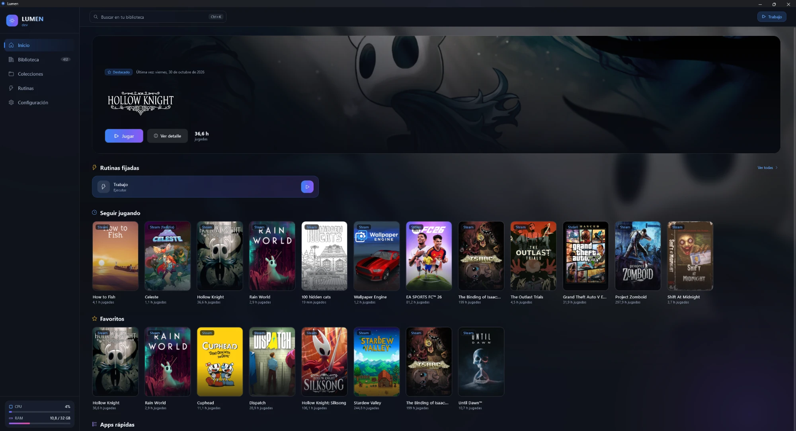
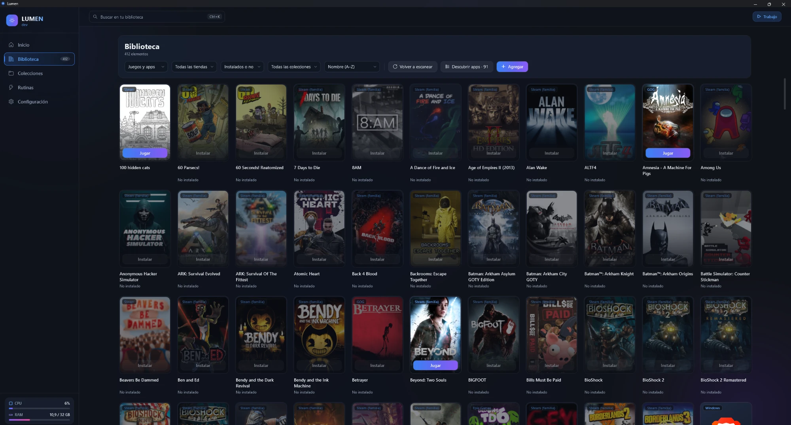
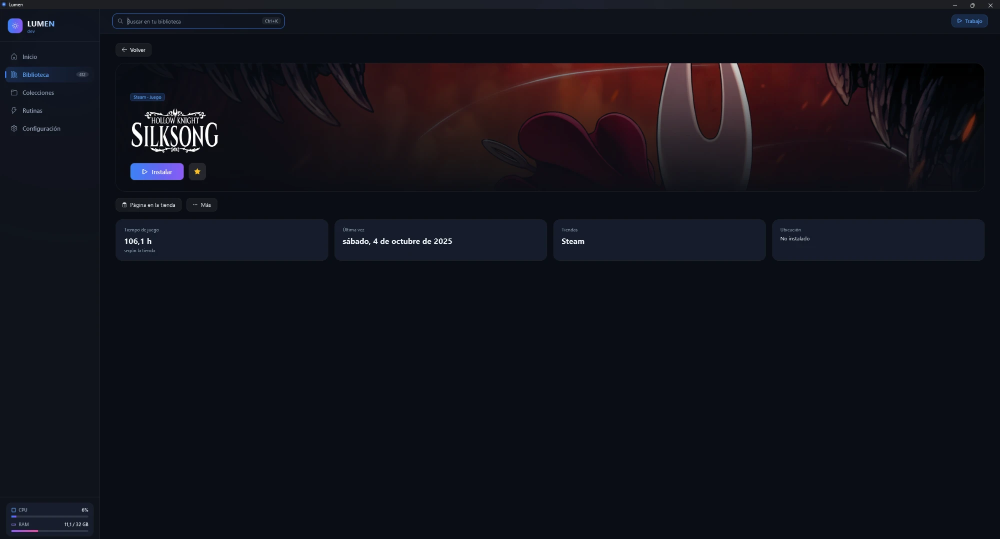
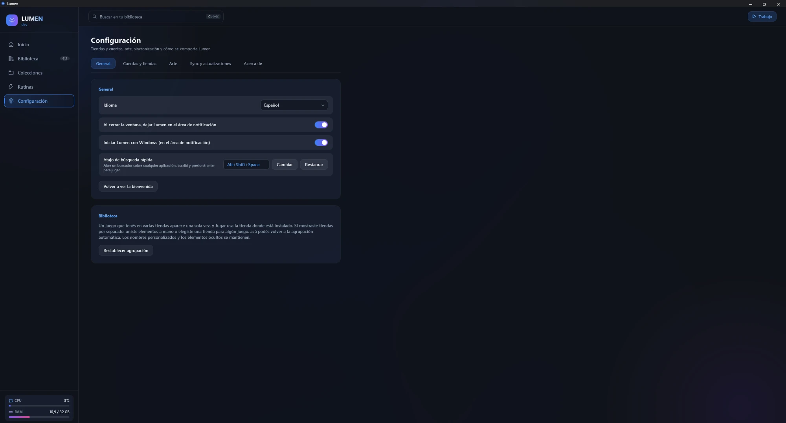

# Lumen

**[Read in English](README.md)**

Lumen es un launcher gratuito y de código abierto para Windows que reúne todos tus juegos y apps en un solo lugar. Steam, Epic, GOG, Xbox / Microsoft Store, Ubisoft Connect, EA app y Battle.net aparecen en una única biblioteca —instalados o no— junto a las apps que elijas. Lanzás cualquier cosa en dos segundos, con mouse, atajo de teclado o joystick.

> **Estado:** beta, camino a la 1.0; hay pre-releases disponibles en la [página de Releases](https://github.com/axelprz/lumen/releases). Ver [el plan de la v1](docs/PLAN-v1.md).



<table>
  <tr>
    <td></td>
    <td></td>
  </tr>
  <tr>
    <td align="center"><sub>Biblioteca: todas las tiendas en una grilla</sub></td>
    <td align="center"><sub>Detalle de un juego</sub></td>
  </tr>
  <tr>
    <td></td>
    <td valign="middle">

**Oscuro, calmo y rápido.** Tarjetas de vidrio, luz ambiente suave, colores tomados del arte de cada juego, animaciones fluidas que respetan los "Efectos de animación" de Windows, y el mismo estilo en el menú de la bandeja y en la búsqueda rápida con <kbd>Alt</kbd>+<kbd>Shift</kbd>+<kbd>Espacio</kbd>.

</td>
  </tr>
  <tr>
    <td align="center"><sub>Configuración</sub></td>
    <td></td>
  </tr>
</table>

## Instalación

Cuando haya un release publicado, bajalo de la [página de Releases](https://github.com/axelprz/lumen/releases): `Lumen-win-Setup.exe` (se instala para tu usuario, sin pedir administrador) o `Lumen-win-Portable.zip` (descomprimilo donde quieras).

Lumen **todavía no está firmado digitalmente**, así que la primera vez Windows SmartScreen puede decir "Windows protegió su PC". Elegí **Más información → Ejecutar de todas formas**. Podés revisar el código y el workflow de releases en este repositorio.

Actualizaciones: Lumen busca una versión nueva al iniciar y una vez por día (lo podés apagar en Ajustes → Actualizaciones). Nunca descarga ni instala solo: vos apretás *Descargar* y después *Reiniciar para actualizar*. Hasta la versión 1.0 todos los releases son pre-releases, por eso el canal por defecto es Beta.

## Qué hace (objetivos de la v1)

- **Una biblioteca para todas las tiendas.** Los juegos instalados se detectan localmente; los que tenés pero no instalaste aparecen en gris y abren el launcher original para instalarlos.
- **Tus apps, curadas.** Lumen encuentra las apps del menú Inicio y elegís cuáles entran a tu biblioteca. Sin basura.
- **Se ve bien.** Interfaz oscura con fondos y colores de acento que siguen el artwork del juego seleccionado (Steam CDN + SteamGridDB).
- **Acceso rápido.** Ícono en la bandeja y un atajo global para un buscador rápido.
- **Navegación con joystick** para el sillón.
- **Horas jugadas** registradas por Lumen, más tus horas existentes de Steam.
- **Rutinas** (opcional): un click abre o cierra un conjunto de apps, sitios y carpetas, por ejemplo "Trabajar". Son archivos JSON que podés sincronizar con una carpeta o compartir.
- **Actualizaciones dentro de la app** vía GitHub Releases. Instalador o zip portable.

## Principios de privacidad y seguridad

- Todo corre localmente. Sin servidores de Lumen, sin telemetría, sin publicidad.
- Los archivos de los launchers solo se **leen**, nunca se modifican.
- Los logins a cuentas son **opcionales**. Tokens y API keys se cifran con DPAPI de Windows y nunca salen de tu PC salvo para hablar con el servicio al que pertenecen. El inicio de sesión de Steam (opcional, para los juegos de la familia) se hace en la web oficial de Steam dentro de Lumen, como en cualquier navegador; Lumen nunca lee esa página ni se hace pasar por otra app o dispositivo.
- DPAPI protege tus keys de otros usuarios de Windows y de una copia del disco o de la base de datos. No puede protegerlas de un malware que ya esté corriendo con tu propio usuario de Windows. **Desconectar** en Configuración revoca el inicio de sesión en la tienda y lo borra de tu PC.
- La v1 no carga plugins ni temas de terceros.
- Las rutinas importadas se muestran completas y hay que aprobarlas antes de poder ejecutarlas.

## Política de privacidad

Lumen no tiene servidores propios y no envía analíticas ni telemetría. Todo lo que guarda (ajustes, caché de la biblioteca, claves protegidas con DPAPI) queda en tu PC, más la carpeta de sync que elijas si activás la sincronización. Las únicas conexiones de red que hace, cada una solo para la función que la necesita, son:

- **Steam Web API y el CDN de imágenes de Steam**: tu biblioteca, horas jugadas y portadas. Tu API key de Steam y tu SteamID64 van solo a Steam.
- **SteamGridDB**: ilustraciones. Tu key de SteamGridDB va solo a SteamGridDB.
- **Servicios de inicio de sesión y biblioteca de Epic y GOG**: solo si conectás esa cuenta.
- **La web de Steam**: solo dentro del navegador de inicio de sesión de Steam que trae Lumen, si elegís iniciar sesión.
- **GitHub Releases**: para buscar y bajar actualizaciones de Lumen. No se envía nada tuyo.

Abrir un enlace en tu navegador (por ejemplo, la página de una tienda) lo hace tu navegador, no Lumen.

## Política de firma de código

Los releases de Lumen **todavía no están firmados** (ver [Instalación](#instalación)). Estamos pidiendo la firma de código gratuita para proyectos de código abierto de la [SignPath Foundation](https://signpath.org/). Esta sección describe la política que vamos a seguir; el instalador sigue sin firmar hasta que la solicitud se apruebe, y entonces se va a actualizar este texto.

- **Qué se firma:** solo los archivos que genera el workflow de releases de GitHub Actions de este repositorio a partir de un commit con tag, nunca un build hecho en la PC de un desarrollador.
- **Roles:** autor, revisor y aprobador son hoy la misma persona, el dueño del proyecto y único mantenedor, [Axel Ismael Perez (AxelPRZ)](https://github.com/axelprz).
- **Aprobación:** cada release lo aprueba el aprobador antes de firmarse. Solo pueden aprobar los miembros con un rol de firma, y todos tienen que usar autenticación multifactor en GitHub y en el servicio de firma.
- **Privacidad:** ver la política de privacidad de arriba. Firmar no agrega nada a lo que Lumen envía.

## Requisitos

- Windows 10 (22H2) o Windows 11, x64
- Opcional: una [API key de Steam](https://steamcommunity.com/dev/apikey) para ver juegos de Steam no instalados y horas
- Opcional: una [API key de SteamGridDB](https://www.steamgriddb.com/profile/preferences/api) para el artwork

## Compilar desde el código

```powershell
git clone https://github.com/axelprz/lumen
cd lumen
dotnet build
dotnet test
```

Requiere el SDK de .NET 10. Para abrir la app: `dotnet run --project src/Lumen.App` (solo Windows).

La estructura del proyecto está en [docs/ARCHITECTURE.md](docs/ARCHITECTURE.md).

## Licencia

Copyright (C) 2026 Axel Ismael Perez (AxelPRZ).

Lumen es software libre publicado bajo la [GNU General Public License v3.0 o posterior](LICENSE). Ver [COPYRIGHT](COPYRIGHT).

La tipografía de la interfaz es Exo 2, © The Exo 2 Project Authors, bajo la [SIL Open Font License 1.1](src/Lumen.App/Assets/Fonts/OFL.txt).

Lumen no está afiliado a Valve, Epic Games, CD PROJEKT, Microsoft, Ubisoft, Electronic Arts, Blizzard ni SteamGridDB. Todas las marcas pertenecen a sus dueños.
