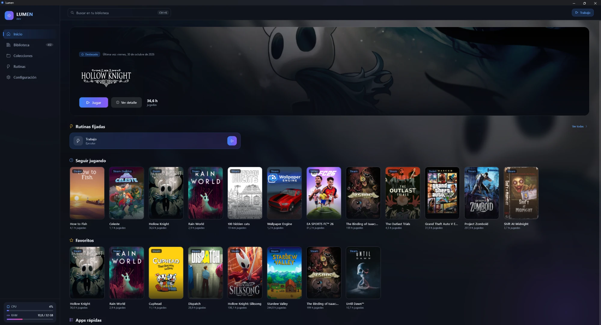
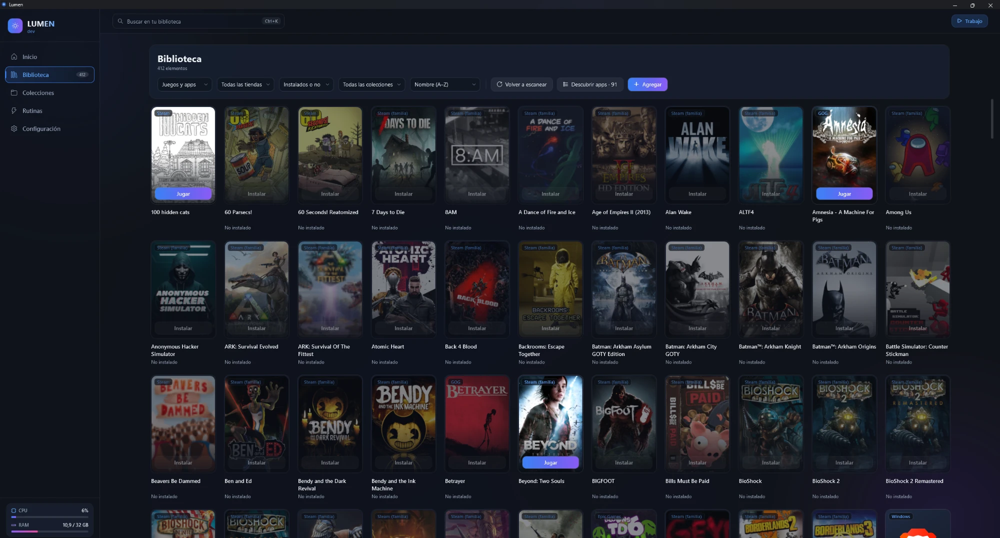
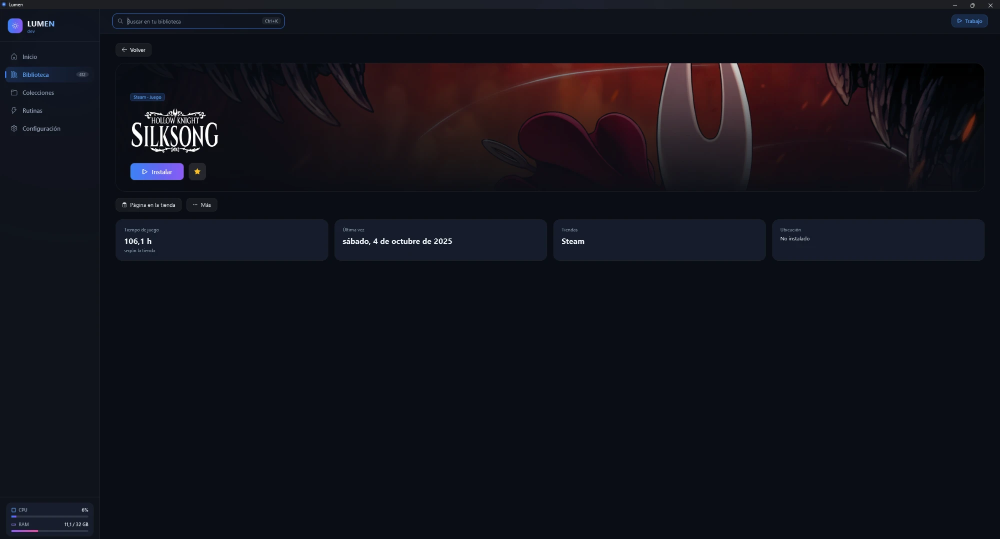
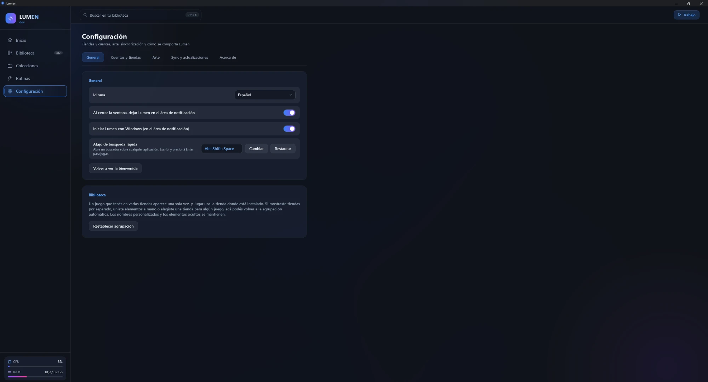

# Lumen

**[Leer en español](README.es.md)**

Lumen is a free, open-source launcher for Windows that brings all your games and apps into one place. Steam, Epic, GOG, Xbox / Microsoft Store, Ubisoft Connect, EA app and Battle.net show up in a single library — installed or not — next to the apps you choose. Launch anything in two seconds, with a mouse, a keyboard shortcut or a gamepad.

> **Status:** beta, on its way to 1.0; pre-releases are available on the [Releases page](https://github.com/axelprz/lumen/releases). See [the v1 plan](docs/PLAN-v1.md).



<table>
  <tr>
    <td></td>
    <td></td>
  </tr>
  <tr>
    <td align="center"><sub>Library: every store in one grid</sub></td>
    <td align="center"><sub>A game's detail</sub></td>
  </tr>
  <tr>
    <td></td>
    <td valign="middle">

**Calm, dark and fast.** Glass cards, soft ambient light, colors taken from each game's art, smooth motion that respects Windows' "Animation effects", and the same look for the tray menu and the <kbd>Alt</kbd>+<kbd>Shift</kbd>+<kbd>Space</kbd> quick search.

</td>
  </tr>
  <tr>
    <td align="center"><sub>Settings</sub></td>
    <td></td>
  </tr>
</table>

## Installing

When a release is published, download it from the [Releases page](https://github.com/axelprz/lumen/releases): `Lumen-win-Setup.exe` (installs for your user, no admin needed) or `Lumen-win-Portable.zip` (unzip anywhere).

Lumen is **not code-signed yet**, so Windows SmartScreen may say "Windows protected your PC" the first time. Choose **More info → Run anyway**. You can check the source and the release workflow in this repository.

If your Windows has **Smart App Control** turned on, it can block unsigned apps and offers no "Run anyway". In that case Lumen will only run after you turn Smart App Control off (Windows Security → App & browser control), which is your decision to make, or once Lumen is signed.

Updates: Lumen looks for a new version when it starts and once a day (you can turn that off in Settings → Updates). It never downloads or installs by itself: you press *Download* and then *Restart to update*. Until version 1.0 every release is a pre-release, so the default channel is Beta.

## What it does (v1 goals)

- **One library for every store.** Installed games are detected locally; owned-but-not-installed games appear greyed out and open the original launcher to install them.
- **Your apps, curated.** Lumen finds the apps in your Start menu and lets you pick which ones belong in your library. No clutter.
- **Looks good.** Dark UI with backgrounds and accent colors that follow the selected game's artwork (Steam CDN + SteamGridDB).
- **Fast access.** Tray icon and a global hotkey for a quick search box.
- **Gamepad navigation** for the couch.
- **Playtime** tracked by Lumen, plus your existing Steam hours.
- **Routines** (optional): one click opens or closes a set of apps, sites and folders — e.g. "Work". Routines are plain JSON files you can sync through a folder or share.
- **In-app updates** via GitHub Releases. Installer or portable zip.

## Privacy and security principles

- Everything runs locally. No Lumen servers, no telemetry, no ads.
- Launcher files are only ever **read**, never modified.
- Account logins are **optional**. Tokens and API keys are encrypted with Windows DPAPI and never leave your PC except to talk to the service they belong to. Steam sign-in (optional, for family games) happens on Steam's own website inside Lumen, like in any browser; Lumen never reads that page and never pretends to be another app or device.
- DPAPI protects your keys from other Windows users and from a copied disk or database. It cannot protect them from malware already running under your own Windows account. **Disconnect** in Settings revokes the sign-in at the store and deletes it from your PC.
- No third-party plugins or themes are loaded in v1.
- Imported routines are shown in full and must be approved before they can run.

## Privacy policy

Lumen has no servers of its own and sends no analytics or telemetry. Everything it stores (settings, library cache, DPAPI-protected keys) stays on your PC, plus the sync folder you choose if you turn sync on. The only network connections it makes, each one only for the feature that needs it, are:

- **Steam Web API and Steam's image CDN**: your library, playtime and covers. Your Steam Web API key and SteamID64 go to Steam only.
- **SteamGridDB**: artwork. Your SteamGridDB key goes to SteamGridDB only.
- **Epic and GOG sign-in and library services**: only if you connect that account.
- **Steam's website**: only inside Lumen's built-in Steam sign-in browser, if you choose to sign in.
- **GitHub Releases**: to look for and download Lumen updates. Nothing about you is sent.

Opening a link in your browser (a store page, for example) is done by your browser, not by Lumen.

## Code signing

The first versions of Lumen are **not code-signed**. We plan to apply for free code signing for open-source projects (SignPath Foundation) once the project has more visibility; this section will then describe the signing policy. Until then, every release is built by this repository's GitHub Actions workflow from a tagged commit, so you can check the source and the workflow yourself.

## Requirements

- Windows 10 (22H2) or Windows 11, x64
- Optional: a [Steam Web API key](https://steamcommunity.com/dev/apikey) to list non-installed Steam games and playtime
- Optional: a [SteamGridDB API key](https://www.steamgriddb.com/profile/preferences/api) for artwork

## Building from source

```powershell
git clone https://github.com/axelprz/lumen
cd lumen
dotnet build
dotnet test
```

Requires the .NET 10 SDK. To open the app: `dotnet run --project src/Lumen.App` (Windows only).

See [docs/ARCHITECTURE.md](docs/ARCHITECTURE.md) for the project layout.

## License

Copyright (C) 2026 Axel Ismael Perez (AxelPRZ).

Lumen is free software released under the [GNU General Public License v3.0 or later](LICENSE). See [COPYRIGHT](COPYRIGHT).

The interface font is Exo 2, © The Exo 2 Project Authors, under the [SIL Open Font License 1.1](src/Lumen.App/Assets/Fonts/OFL.txt).

Lumen is not affiliated with Valve, Epic Games, CD PROJEKT, Microsoft, Ubisoft, Electronic Arts, Blizzard or SteamGridDB. All trademarks belong to their owners.
